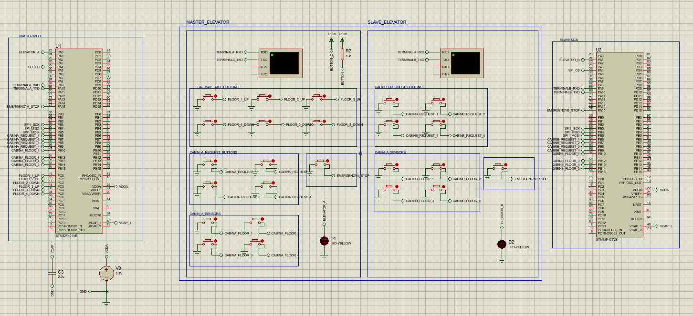

# Collaborative Dual-Elevator Controller over SPI — Bare-Metal STM32F401

Two STM32F401 microcontrollers each control one elevator and work together over an SPI link. The **master** MCU runs a dispatcher that assigns hall calls to whichever car is better placed to answer them. The **slave** MCU runs its own car and reports its state back every cycle. All drivers are written at register level, without HAL.

> **Course project:** Embedded Systems (SBE, Cairo University), Spring 2026, final project, team of 4. Simulated in Proteus with two MCUs; it was not run on physical hardware.

---

## Features

- **Two-MCU architecture from one codebase.** The role is chosen at compile time (`BOARD_ROLE_MASTER` / `BOARD_ROLE_SLAVE`) through CMake.
- **Inter-processor communication** over full-duplex SPI with a fixed 8-byte frame, a sync header and an XOR checksum (see [`packet_definition.md`](packet_definition.md)).
- **Elevator finite-state machine** for 4 floors: IDLE, MOVING_UP, MOVING_DOWN, DOORS_OPEN, DOORS_CLOSING and EMERGENCY.
- **Dispatcher** on the master. It assigns each hall call by distance and by whether a car is already moving toward that floor in the requested direction, and it can defer a call that neither car can take yet.
- **Fault tolerance.** If no valid frames arrive for a set number of cycles, the link is declared faulty and the master serves every call by itself. An independent watchdog (IWDG, 1 s) resets the MCU if the software hangs.
- **Interrupt-driven I/O.** EXTI drives the hall-call buttons and the emergency stop. PWM drives the motor. USART telemetry runs over DMA through a ring buffer.
- **Prioritised interrupts:** emergency stop > SPI and scheduler > telemetry > DMA completion (see [`INTERRUPT_PRIORITY_MAPPING.md`](INTERRUPT_PRIORITY_MAPPING.md)).
- **Cooperative scheduler** with 10 / 50 / 100 / 500 ms tasks, driven by SysTick (1 ms) and TIM5.

## Hardware (Proteus)



The schematic has two STM32F401VE MCUs: U1 is the master and controls elevator A, and U2 is the slave and controls elevator B. They are linked over SPI1 (SCK, MISO, MOSI and chip select). Each elevator has:
- a virtual UART terminal for telemetry and debug logs;
- four cabin request buttons, one per floor;
- four cabin floor sensors, simulated with push buttons;
- an emergency-stop button;
- a yellow LED showing the motor (PWM) output.

The six hallway call buttons (floors 1–3 up, floors 2–4 down) are wired to the master only, because the master's dispatcher assigns each call to a car.

## SPI frame (8 bytes)

| Byte | Field | Notes |
|---|---|---|
| 0 | Header | `0xA5` sync byte |
| 1 | FSM state | |
| 2 | Current floor | 1–4 |
| 3 | Direction | none / up / down |
| 4–5 | Request queue | floor bitmask |
| 6 | Flags | master-to-slave commands |
| 7 | Checksum | XOR of bytes 0–6 |

The SPI clock runs at f<sub>PCLK</sub>/256 (62.5 kHz) to keep transfers reliable in simulation. The slave uses hardware NSS, and separate TX and RX buffer indices prevent byte shifting.

## Repository layout

```
App/          Elevator_FSM, Dispatcher, HallCallButtons, IPC, Telemetry, System (scheduler, init)
Spi/          non-blocking, interrupt-driven SPI driver (master and slave)
Usart/ Dma/ RingBuffer/   non-blocking UART with DMA transmit and a ring buffer
Timer/ Pwm/   timers, PWM motor control, PWM scheduler
Exti/ Nvic/ Gpio/ Rcc/ Iwdg/   interrupts, GPIO, clocks, watchdog
Test/         standalone master/slave driver-test firmware
cmake/        ARM toolchain and build configuration
```

## Build

Requirements: CMake, `arm-none-eabi-gcc`, and the bundled STM32-base files.

```bash
# Master firmware (MCU A)
cmake -S . -B build_master -DBOARD_ROLE_MASTER=1 && cmake --build build_master
# Slave firmware (MCU B)
cmake -S . -B build_slave  -DBOARD_ROLE_SLAVE=1  && cmake --build build_slave
# Driver-test firmware
cmake -S . -B build_test -DDRIVER_TEST_MASTER=ON   # or -DDRIVER_TEST_SLAVE=ON
```

Load each image into its MCU in the Proteus schematic.

## Team

| Member | Main contributions |
|---|---|
| Nour Bahgat | Project setup and build system; driver layer (RCC, GPIO, NVIC, EXTI, Timer, PWM, USART, ring buffer); non-blocking SPI driver and the IPC packet frame; watchdog module; communication-fault trigger; master/slave integration and debugging (SPI ISR, slave pre-loading, DMA stabilisation, simulation timing); driver-test firmware; interrupt-priority documentation |
| Rahma Fathy | Telemetry subsystem with DMA-based UART; PWM motor control and scheduler; system scheduler and initialisation |
| Farida Abdelrahman | Dispatcher (task-allocation algorithm), hall-call EXTI handling, comm-fault fallback logic, packet definition table |
| Nour Allah Hassan | Elevator finite-state machine |
